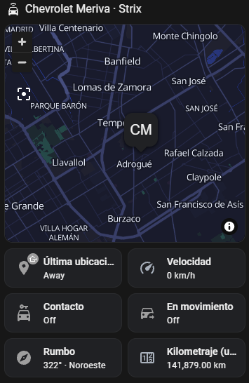
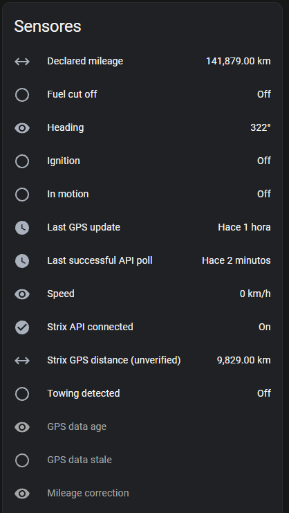

# Strix Argentina for Home Assistant

> **Recommended:** Install through **HACS** for easier updates. Add this repository as a custom integration repository, download it, then use **Add Integration** to configure your Strix account. The repository must be public for other users to access it.

Unofficial Home Assistant integration for Strix Argentina vehicle GPS tracking (the service formerly known as LoJack Argentina).

> [!IMPORTANT]
> This is an independent community project. It is **not affiliated with, endorsed by, or supported by Strix Argentina, LoJack, or their respective owners**. Strix, LoJack and their associated names and logos are trademarks of their respective owners. References to those marks are for identification only; no trademark rights or official affiliation are claimed.

## Table of contents

- [Strix and LoJack](#strix-and-lojack)
- [Features](#features)
- [Screenshots](#screenshots)
- [Requirements](#requirements)
- [Installation](#installation)
  - [Manual installation](#manual-installation)
  - [HACS custom repository](#hacs-custom-repository)
- [Authentication](#authentication)
- [Upgrading an existing manual installation](#upgrading-an-existing-manual-installation)
- [Privacy](#privacy)
- [Diagnostics and troubleshooting](#diagnostics-and-troubleshooting)
- [Development and validation](#development-and-validation)
- [Postman API collection](#postman-api-collection)
- [License and trademarks](#license-and-trademarks)

## Strix and LoJack

**Strix Argentina is associated with the vehicle tracking service previously known as LoJack Argentina.** The service has also used branding such as *Strix by LoJack*. This historical reference is included to help users of the former LoJack Argentina service discover the integration; it does **not** imply that this project is an official LoJack or Strix product.

The integration uses the **Strix Argentina** name because it connects to the Strix platform and API. The Home Assistant integration name and GitHub repository name remain unchanged for compatibility and clarity.

## Features

- Vehicle GPS location via a `device_tracker` entity
- Speed, heading, user-declared mileage, reported GPS distance, last GPS update and GPS age
- Ignition, motion, towing and fuel-cutoff binary sensors
- Automatic polling approximately every 120 seconds
- Vehicle metadata from the Strix API
- Automatic discovery of newly added vehicles during polling (no restart required)
- Safe integration diagnostics and English/Spanish configuration translations
- Password reauthentication from Home Assistant without removing the account
- GPS coordinate validation and optional binary GPS staleness indicator (15-minute threshold)
- Last successful Strix API poll sensor and API connection status binary sensor

**Limitations:** Strix GPS data may be delayed or unavailable. The meaning of the reported GPS distance has not been independently verified. This integration is not an emergency, safety or guaranteed real-time tracking system.

## Screenshots

The screenshots below show a real Home Assistant dashboard and the entities exposed by the Strix Argentina integration. Displayed values are examples from one vehicle; available entities and values depend on the Strix account and vehicle.

<table>
  <tr>
    <td align="center" width="50%"><strong>Vehicle dashboard</strong></td>
    <td align="center" width="50%"><strong>Vehicle sensors</strong></td>
  </tr>
  <tr>
    <td valign="top"></td>
    <td valign="top"></td>
  </tr>
</table>

## Requirements

- Home Assistant with custom integration support
- An active Strix Argentina account with access to at least one vehicle
- Strix account username and password
- The OAuth Basic Authorization client value required by the Strix API
- Network access to `https://api.strix.com.ar`

## Installation

### Recommended: HACS (custom repository)

1. Install [HACS](https://www.hacs.xyz/) in Home Assistant if you do not already have it.
2. Click the button above to open this repository in your Home Assistant instance. If prompted, add it as a **custom repository** of type **Integration**. Alternatively, open **HACS → three-dot menu → Custom repositories** and enter `https://github.com/ImNotThrasher/ha-strix-argentina` with type **Integration**.
3. Download the integration from HACS and follow any restart prompt.
4. Click **Add Integration** below and enter your Strix account credentials and required API client authorization value.

**Note:** The repository is not currently listed in the default HACS catalog. A custom repository is sufficient; listing in the default catalog is a separate review process. 

### Alternative: manual installation

1. Download the [latest release](https://github.com/ImNotThrasher/ha-strix-argentina/releases/latest).
2. Copy `custom_components/strix_argentina` into the `custom_components` folder in your Home Assistant configuration directory.
3. Restart Home Assistant.
4. Open **Settings → Devices & services → Add integration**, search for **Strix Argentina**, and complete the configuration form.

Manual installation works without HACS, but updates must be installed manually. **Do not install both ways independently or delete an existing configuration entry when switching methods.** See [upgrading an existing manual installation](#upgrading-an-existing-manual-installation).

## Authentication

The configuration form requests:

| Field | Description |
| --- | --- |
| Username | Strix account username |
| Password | Strix account password |
| Client device ID | Optional; leave blank to generate a UUID during initial setup |
| OAuth Basic Authorization | API client authorization value following `Basic ` in the Authorization header (omit the prefix) |

The integration authenticates using the Strix OAuth endpoint and obtains access and refresh tokens. The account credentials and OAuth Basic value are stored in Home Assistant's config-entry storage, **not in this GitHub repository**; access and refresh tokens are held in memory. The OAuth Basic client value is **not** the same thing as your account password.

The integration does not currently provide an automated way to obtain the OAuth Basic client value. The API and its authentication flow are unofficial and may change without notice.

**Never publish credentials, tokens, authorization headers, Home Assistant backups or the `.storage` directory.**

### How to find the OAuth Basic value

1. Sign in at [Strix customer portal](https://clientes.strix.com.ar/login) with your own account.
2. Open your browser's developer tools (F12) and select the Network tab.
3. Look for the authentication request to the Strix API.
4. In its request headers, find the Basic authorization value.
5. Enter the client value in the integration's OAuth Basic Authorization field, without the prefix.

Keep this value private. Never publish authorization headers, passwords, tokens, or browser network exports.

## Upgrading an existing manual installation

The integration intentionally preserves the domain `strix_argentina` and existing entity unique IDs. This helps retain entity registry entries, dashboards, automations and history.

1. Back up your Home Assistant configuration.
2. **Do not delete the Strix Argentina integration** from Devices & services or remove its entities.
3. When HACS installation is available, install the custom repository over the existing component files.
4. Restart Home Assistant and verify entity IDs and dashboard references.
5. Use HACS for future updates instead of manually overwriting the same files.

Always verify your installation before making changes. Existing dashboards depend on your Home Assistant entity registry, not just the repository name.

## Privacy

Vehicle locations, license plates, device identifiers and credentials are sensitive. Limit access to your Home Assistant instance, dashboards, diagnostics and backups.

## Diagnostics and troubleshooting

From **Settings → Devices & services → Strix Argentina**, download integration diagnostics when investigating issues. Diagnostics include the vehicle count, last update status and polling interval. Account credentials are redacted; vehicle identifiers, location coordinates and raw API payloads are intentionally omitted. Do not assume every diagnostic or Home Assistant log is safe to publish without reviewing it.

Transient API outages are reported as update failures. Rejected account credentials are treated as authentication failures and may trigger Home Assistant reauthentication handling. Newly added vehicles are registered after a successful poll; existing entity unique IDs are preserved. Vehicles removed from the account become unavailable rather than having their registry entries deleted.

## Development and validation

For the current stable version, see the [latest release](https://github.com/ImNotThrasher/ha-strix-argentina/releases/latest); previous versions are listed under [all releases](https://github.com/ImNotThrasher/ha-strix-argentina/releases). Multi-vehicle behavior was validated with simulated vehicles in an isolated Home Assistant test environment; it has not been tested with a real Strix account containing multiple vehicles. The API is unofficial. Bug reports and contributions are welcome. Hassfest runs on every push and pull request; the HACS validation job runs only when the repository is public. The Python unit suite covers payload helpers, GPS coordinate validation, OAuth refresh and error handling, and dynamic vehicle discovery. Ruff lint and Python compilation also run in CI. Run locally with `python -m pip install aiohttp` and `python -m unittest discover -s tests`. These checks validate packaging and selected behavior; they do not guarantee that the external Strix API will remain compatible.

## Postman API collection

A [read-only Postman collection](docs/postman/strix-argentina.postman_collection.json) is available for developers who want to inspect the unofficial Strix API without running Home Assistant. Import the JSON file into Postman and set the collection variables `username`, `password`, and `oauth_basic` locally. The `oauth_basic` value is the encoded OAuth client credential **without** the `Basic ` prefix; it is not your Strix account password.

Run **01 - Authenticate (password)** to obtain and store the access and refresh tokens in collection variables. **02 - Refresh token** renews the access token, and **03 - List vehicles** fetches vehicle data. Both OAuth requests were manually tested successfully without `client_device_id`; the request body field is disabled by default and can be enabled if needed. The Home Assistant integration may still send a generated client device ID.

The collection contains no credentials, tokens, real vehicle identifiers, or saved responses. **Before sharing an exported or modified copy, clear all sensitive collection variable values and inspect saved examples/responses.** Postman's `secret` variable type does not guarantee that values are excluded from exports. This is an unofficial API and its behavior may change without notice.

## Development branches and releases

- **`dev`** is the development branch for changes and experiments. Open pull requests against `dev` during development.
- **`main`** is reserved for validated stable code. Promote changes from `dev` to `main` only after review and successful CI checks.
- Published GitHub releases and version tags are created from `main`; the release version should match `custom_components/strix_argentina/manifest.json`.
- GitHub Actions runs unit tests, an isolated Home Assistant runtime test, Ruff, and Hassfest. The HACS validation job runs when the repository is public. A successful automated run does not guarantee compatibility with future Strix API changes.

## License and trademarks

The source code is licensed under the **GNU General Public License v3.0 (GPL-3.0)**. See [LICENSE](LICENSE). The Strix and LoJack names and logos belong to their respective owners; the project's trademark disclaimer does not constitute a license to use third-party assets.
